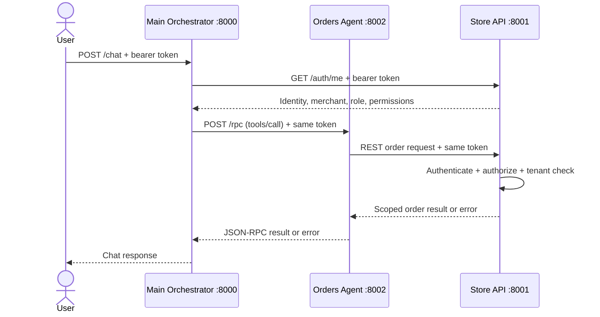

# 🛒 ShopHub - Part I: Basic Order Support Architecture

## 1. Overview

ShopHub is a multi-tenant e-commerce platform. Different merchants
operate independent stores on the same platform. Staff members use a
chat interface to ask questions about orders and, when permitted,
request order cancellations or refunds.

**Part I focuses on basic order support and tenant isolation.** It
demonstrates how a request is authenticated, interpreted, sent to the
order service, checked against permissions and merchant ownership, and
returned to the user.

> This is a demonstration implementation. The Store API uses in-memory
> sample data and simulated order actions; it does not connect to a real
> payment provider.

## 2. Goals

-   Allow authenticated staff to list and look up orders.
-   Keep each merchant's data isolated from other merchants.
-   Apply role-based access control (RBAC) to order operations.
-   Support eligible order cancellations and simulated refunds.
-   Keep service responsibilities separate and easy to test.
-   Return clear success or error responses.

## 3. High-level architecture


<!-- ``` mermaid
flowchart TD
    U[Staff User] -->|Chat request + bearer token| O[Main Orchestrator<br/>FastAPI :8000]
    O -->|Verify identity| S[Store API<br/>FastAPI :8001]
    O -->|JSON-RPC tools/call + same bearer token| A[Orders Agent<br/>FastAPI :8002]
    A -->|REST request + same bearer token| S
    S --> AUTH[Authenticate token]
    AUTH --> RBAC[Check role and permission]
    RBAC --> TENANT[Check merchant ownership]
    TENANT --> DATA[(In-memory sample orders)]
    DATA --> S
    S --> A
    A --> O
    O --> U
``` -->

### Components

  ------------------------------------------------------------------------
  Component                             Default port Responsibility
  --------------------- ---------------------------- ---------------------
  Main Orchestrator                             8000 Receives
  (`main.py`)                                        natural-language
                                                     requests, verifies
                                                     the user, classifies
                                                     intent using simple
                                                     rules, and calls the
                                                     appropriate tool.

  Orders Agent                                  8002 Exposes order tools
  (`orders_agent.py`)                                and accepts tool
                                                     calls through a
                                                     JSON-RPC 2.0 endpoint
                                                     at `/rpc`.

  Store API                                     8001 Source of truth for
  (`store_api.py`)                                   authentication,
                                                     roles, permissions,
                                                     merchant-scoped order
                                                     access, and order
                                                     status changes.

  In-memory sample data                          --- Holds demonstration
                                                     merchants and orders
                                                     while the Store API
                                                     process is running.
  ------------------------------------------------------------------------

**Security principle:** the bearer token is forwarded unchanged through
the service chain. The Store API must enforce permissions and merchant
ownership; the orchestrator or agent must not be treated as the final
security boundary.

## 4. Request workflow

Example user message: `Show my orders`

1.  The user sends a message to `POST /chat` on the Main Orchestrator
    and includes an Authorization bearer token.
2.  The Main Orchestrator calls `GET /auth/me` on the Store API to
    verify the token and obtain the user's identity, merchant, role, and
    permissions.
3.  The orchestrator classifies the message. For this example, the
    intent is `list_orders`.
4.  The orchestrator calls `POST /rpc` on the Orders Agent using
    JSON-RPC 2.0 and forwards the bearer token.
5.  The Orders Agent maps the tool call to a Store API endpoint, such as
    `GET /orders`.
6.  The Store API validates the token, checks `orders:read`, and returns
    only orders owned by the authenticated merchant.
7.  The response travels back through the Orders Agent and orchestrator
    to the user.

### Sequence diagram



## 5. Authentication, tenants, and roles

### Demo identities

  Token               User         Merchant       Role
  ------------------- ------------ -------------- ------------------
  `token-a-admin`     `user-001`   `merchant-a`   `merchant_admin`
  `token-a-support`   `user-002`   `merchant-a`   `support_agent`
  `token-a-viewer`    `user-003`   `merchant-a`   `viewer`
  `token-b-manager`   `user-004`   `merchant-b`   `order_manager`

These are **demo tokens only**. Do not use hard-coded tokens in a
production system.

### Permission matrix

  Operation                  Merchant admin   Support agent   Viewer   Order manager
  ------------------------ ---------------- --------------- -------- ---------------
  Read/list orders                      Yes             Yes      Yes             Yes
  Cancel eligible orders                Yes             Yes       No             Yes
  Refund eligible orders                Yes              No       No             Yes
  Manage staff                          Yes              No       No              No

The Store API is responsible for enforcing this matrix. A user must not
gain additional permissions by asking the chat assistant to ignore
access rules.

### Tenant isolation

-   The authenticated token determines the merchant identity.
-   Order lookups must check both the order ID and the authenticated
    merchant ID.
-   A user from `merchant-a` must not receive order details for
    `merchant-b`.
-   In this demo, a missing or foreign-merchant order is expected to
    return `404 Not Found` to avoid revealing another merchant's order.
-   Never trust a `merchant_id` supplied by the user in a chat message
    or tool arguments as proof of access.

## 6. Order tools and business rules

  -----------------------------------------------------------------------------
  Tool                    Purpose                 Typical Store API endpoint
  ----------------------- ----------------------- -----------------------------
  `list_orders`           List the current        `GET /orders`
                          merchant's orders;      
                          optionally filter by    
                          status                  

  `get_order`             Look up an order within `GET /orders/lookup?id=...`
                          the current merchant    

  `cancel_order`          Cancel an eligible      `POST /orders/cancel`
                          order                   

  `refund_order`          Simulate a refund for   `POST /orders/refund`
                          an eligible order       
  -----------------------------------------------------------------------------

The demo business rules include:

-   Cancellation is allowed only when the order is in `processing`
    status.
-   Refund is allowed only for a `delivered` order and should not be
    applied twice.
-   The caller must have the corresponding permission.
-   The order must belong to the authenticated merchant.
-   Refunds only update mock order status; no real money is moved.

Actual status names and rules should be checked against the current
source code if they are changed during development.

## 7. API endpoints

### Store API --- `http://127.0.0.1:8001`

  ------------------------------------------------------------------------------
  Method                  Path                           Purpose
  ----------------------- ------------------------------ -----------------------
  `GET`                   `/`                            Health check

  `GET`                   `/auth/me`                     Return authenticated
                                                         identity and
                                                         permissions

  `GET`                   `/orders`                      List merchant-scoped
                                                         orders

  `GET`                   `/orders/lookup?id=ORD-1001`   Look up one
                                                         merchant-scoped order

  `POST`                  `/orders/cancel`               Cancel an eligible
                                                         order

  `POST`                  `/orders/refund`               Simulate a refund for
                                                         an eligible order
  ------------------------------------------------------------------------------

### Orders Agent --- `http://127.0.0.1:8002`

  -----------------------------------------------------------------------
  Method                  Path                    Purpose
  ----------------------- ----------------------- -----------------------
  `GET`                   `/`                     Health check

  `GET`                   `/tools`                List available tools

  `POST`                  `/rpc`                  JSON-RPC 2.0 endpoint
                                                  for `tools/list` and
                                                  `tools/call`
  -----------------------------------------------------------------------

Example JSON-RPC request to look up an order:

``` json
{
  "jsonrpc": "2.0",
  "id": 1,
  "method": "tools/call",
  "params": {
    "name": "get_order",
    "arguments": {
      "order_id": "ORD-1001"
    }
  }
}
```

For `tools/call`, send the HTTP header
`Authorization: Bearer token-a-admin`. The token belongs in the HTTP
header, not in the JSON-RPC body.

### Main Orchestrator --- `http://127.0.0.1:8000`

  Method   Path      Purpose
  -------- --------- --------------------------------------------------
  `GET`    `/`       Health check and configured service URLs
  `POST`   `/chat`   Process a natural-language order-support request

Example chat request:

``` json
{
  "message": "Find order ORD-1001"
}
```

Include `Authorization: Bearer token-a-admin` as an HTTP header. The
orchestrator's current intent classifier is rule-based; it is not an
LLM.

## 8. Run locally

Open separate terminals in the project directory. Use `uv` as the Python
environment and package runner.

### Terminal 1 --- Store API

``` powershell
uv run uvicorn store_api:app --reload --port 8001
```

### Terminal 2 --- Orders Agent

``` powershell
uv run uvicorn orders_agent:app --reload --port 8002
```

### Terminal 3 --- Main Orchestrator

``` powershell
uv run uvicorn main:app --reload --port 8000
```

Open the interactive API documentation:

-   Main Orchestrator: http://127.0.0.1:8000/docs
-   Store API: http://127.0.0.1:8001/docs
-   Orders Agent: http://127.0.0.1:8002/docs

If the project has not been installed in the environment yet, install
its declared dependencies with the project's chosen `uv` workflow before
starting the services. Keep each service running while testing the
complete request chain.

## 9. Test plan

Run these checks in order. Use the actual HTTP response and response
body to record results; do not mark a test passed until it has been
executed.

  ------------------------------------------------------------------------
                            \# Test                  Expected outcome
  ---------------------------- --------------------- ---------------------
                             1 `GET /auth/me` with   Identifies
                               `token-a-admin`       `merchant-a` and the
                                                     admin role

                             2 `GET /orders` with    Lists only
                               `token-a-admin`       `merchant-a` orders

                             3 Look up `ORD-1001`    Returns that
                               with `token-a-admin`  merchant's order

                             4 Look up `ORD-2001`    `404 Not Found`; no
                               with `token-a-admin`  foreign order details

                             5 Cancel an eligible    Successful status
                               `processing` order as change to `cancelled`
                               admin                 

                             6 Attempt cancellation  `403 Forbidden`
                               as `token-a-viewer`   

                             7 Attempt refund as     `403 Forbidden`
                               `token-a-support`     

                             8 Refund an eligible    Simulated status
                               `delivered` order as  change to `refunded`
                               admin                 

                             9 Call `tools/list` on  Lists the supported
                               `/rpc`                tools

                            10 Call `tools/call` on  Authorization error
                               `/rpc` with no token  

                            11 Submit                Returns only the
                               `Show my orders` to   authenticated
                               `/chat`               merchant's orders
  ------------------------------------------------------------------------

**Tip:** order actions change the in-memory data. For repeatable tests,
restart the Store API to reload its seed data, then re-run tests in a
known order.

## 10. Error handling

  -----------------------------------------------------------------------
  Status / error                      Meaning
  ----------------------------------- -----------------------------------
  `401 Unauthorized`                  Missing, malformed, or invalid
                                      bearer token

  `403 Forbidden`                     Authenticated user lacks the
                                      required permission

  `404 Not Found`                     Order does not exist for the
                                      authenticated merchant

  `400 Bad Request`                   Request cannot be classified or
                                      fails business validation

  `502 Bad Gateway`                   A downstream service cannot be
                                      reached or returns an unexpected
                                      response

  `504 Gateway Timeout`               A downstream service timed out
  -----------------------------------------------------------------------

Exact error formatting can differ between a REST response and the
JSON-RPC error object.

## 11. Current limitations

-   Demo bearer tokens are hard-coded and are not a production identity
    system.
-   Orders are held in memory and are lost/reset when the Store API
    process restarts.
-   The orchestrator uses keyword/rule-based intent classification
    rather than an LLM.
-   Refunds are simulated; no payment gateway is connected.
-   This architecture is for local demonstration and learning, not
    production deployment.
-   Production systems need durable storage, managed secrets, audit
    logs, rate limiting, stronger identity integration, monitoring, and
    automated security tests.

## 12. Part I completion criteria

Part I can be considered demonstrated when the team can show:

1.  A valid token identifies the correct user, merchant, role, and
    permissions.
2.  Order listing and lookup are restricted to the user's merchant.
3.  The Store API enforces role permissions even when a tool is called
    directly.
4.  The Orders Agent forwards the bearer token to the Store API.
5.  The Main Orchestrator can process a chat request end to end.
6.  Expected success and denial cases are documented with actual test
    results.

------------------------------------------------------------------------

**Architecture summary:** The Main Orchestrator understands the user's
request, the Orders Agent invokes the relevant tool, and the Store API
is the final authority for identity, permission checks, and
merchant-level data isolation.
